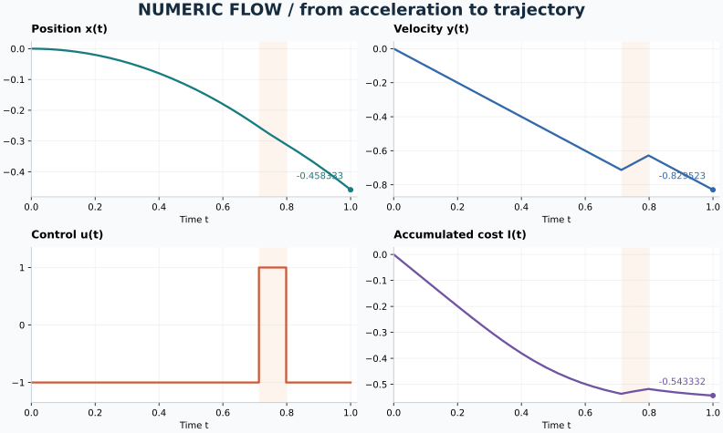

# Numeric Flow

**Численные методы и оптимальное управление: восстановленный эксперимент на Python и C++.**

An old C++ numerical experiment, restored as two independent, dependency-free
implementations. Adaptive Dormand–Prince 5(4), complete switching-time detection,
and bracketed shooting. Runs on macOS and Linux.



## Что здесь происходит

Точка движется по прямой: `x` — положение, `y` — скорость, `u` — ускорение.
Ускорение переключается между `−1` и `+1`. Нужно за одну единицу времени попасть
из состояния покоя в `x(1) = −11/24`, выбирая моменты переключения.

В старой программе для этого использовались:

- **Дорман—Принс 5(4)** — метод Рунге—Кутты с автоматическим выбором шага;
- **бисекция** — поиск моментов смены управления;
- **метод стрельбы** — подбор начального сопряжённого параметра для краевого условия;
- **интегрирование стоимости** `I = ∫ u(t)/(1 + αt⁴) dt` вместе с траекторией.

Это учебный численный решатель конкретной задачи оптимального управления.
Математическая постановка восстановлена по коду: оригинальное условие задачи
не сохранилось. Почему здесь появляются сопряжённые переменные и что именно
минимизируется, разобрано в [математике](docs/mathematics.md).

## Быстрый запуск

Все команды выполняются из корня проекта. Обе версии работают самостоятельно.
Python не нужен для запуска C++-программы, C++ не нужен для Python-программы.

### Python 3.10+

Без установки пакетов:

```bash
python3 -m pysource
mkdir -p results
python3 -m pysource --output results/python.csv
```

Для установки как команды в отдельное окружение:

```bash
python3 -m venv .venv
source .venv/bin/activate
python -m pip install -e .
numeric-flow --help
```

### C++17 и CMake 3.16+

Нужны Clang или GCC и CMake. В macOS компилятор входит в Xcode Command Line Tools
(`xcode-select --install`), CMake можно установить через `brew install cmake`.
В Debian/Ubuntu: `sudo apt-get install build-essential cmake`.

```bash
cmake -S . -B build -DCMAKE_BUILD_TYPE=Release
cmake --build build --parallel
mkdir -p results
./build/numeric-flow --output results/cpp.csv
```

### Параметры

Оба CLI принимают одинаковые параметры и возвращают JSON в stdout.

| Параметр | По умолчанию | Смысл |
| --- | --- | --- |
| `--alpha` | `11` | Вес в стоимости, конечное число `≥ 0` |
| `--target` | `-11/24` | Конечная координата, строго между `−0.5` и `0.5` |
| `--parameter` | подбирается | Задать `p` вручную и пропустить стрельбу, `p ≥ 0` |
| `--atol` | `1e-11` | Абсолютный допуск локальной погрешности, `> 0` |
| `--rtol` | `1e-9` | Относительный допуск локальной погрешности, `≥ 0` |
| `--max-step` | `0.05` | Максимальный шаг по времени, `> 0` |
| `--boundary-tol` | `1e-10` | Допуск для `abs(x(1) − target)`, `> 0` |
| `--output` | без файла | Путь к CSV; родительская папка должна существовать |

Числа передаются десятичной записью, например `--target -0.4`, а не дробью
`--target -2/5`. Время `[0,1]` и начальные `x(0)=y(0)=0` фиксированы.

```bash
# Случай с известным аналитическим решением
python3 -m pysource --alpha 0

# Три переключения при фиксированном параметре
./build/numeric-flow --parameter 1.05 --output results/three-switches.csv
```

CSV содержит `t,x,y,p_x,p_y,u,integral`, включая начальную и конечную точки.
В точке переключения `u` относится к следующему интервалу (правостороннее
значение). Существующий файл по указанному пути перезаписывается.
`accepted_steps` и `rejected_steps` относятся к последней траектории,
`shooting_iterations` — к итерациям бисекции после поиска скобки.

## Контрольный результат

При `α = 11` и остальных параметрах по умолчанию:

| Величина | Приближённое значение |
| --- | ---: |
| Найденный параметр `p` | `0.90672636` |
| Первое переключение | `0.71296803` |
| Второе переключение | `0.79820634` |
| `x(1)` | `−0.45833333` |
| `y(1)` | `−0.82952340` |
| `I(1)` | `−0.54333165` |

Управление: сначала `−1`, затем короткий участок `+1`, затем снова `−1`.
Последние разряды и адаптивные сетки могут различаться между компиляторами.
Допуски локальной ошибки не являются строгой гарантией глобальной ошибки.

## Проверки

```bash
# Python, без компилятора (межъязыковые проверки будут пропущены)
python3 -m unittest discover -s tests -v

# C++ и, если Python найден CMake, весь Python-набор с проверкой совпадения версий
ctest --test-dir build --output-on-failure

# Явный запуск межъязыковых проверок
NUMERIC_FLOW_CPP="$PWD/build/numeric-flow" python3 -m unittest discover -s tests -v

# Проверка в отдельном Linux-контейнере (нужен запущенный Docker)
sh scripts/test-linux.sh
```

Проверяются аналитическое решение при `α = 0`, движение с постоянным ускорением,
случаи с несколькими переключениями, интеграл независимым методом Симпсона,
отклонение слишком большого шага, некорректные входные данные, CSV и согласованность
Python/C++. Матрица GitHub Actions для macOS/Linux подготовлена в
[ci.yml](.github/workflows/ci.yml); локальный проект никуда не опубликован.
Фактически проверенные среды перечислены в [протоколе проверки](docs/verification.md).

## Построить график

Matplotlib нужен только для рисунка:

```bash
python3 -m venv .venv
source .venv/bin/activate
python -m pip install -e '.[plot]'
mkdir -p results
python -m pysource --output results/python.csv
python examples/plot.py results/python.csv --output results/trajectory.svg
```

## Устройство проекта

```text
pysource/             Python: интегратор, решатель, CLI
cpp/include/          Публичный интерфейс C++
cpp/src/              Независимая реализация C++ и CLI
cpp/tests/            Численные тесты C++
tests/                Python, CLI и сравнение двух версий
examples/plot.py       Воспроизводимый график из CSV
docs/                 Математика и журнал восстановления
```

Список исправлений и границы поддержки — в [журнале восстановления](docs/restoration.md).
Исторический исходник (`archive/`) и служебные планы (`docs/superpowers/`)
сохранены локально и исключены из Git.
